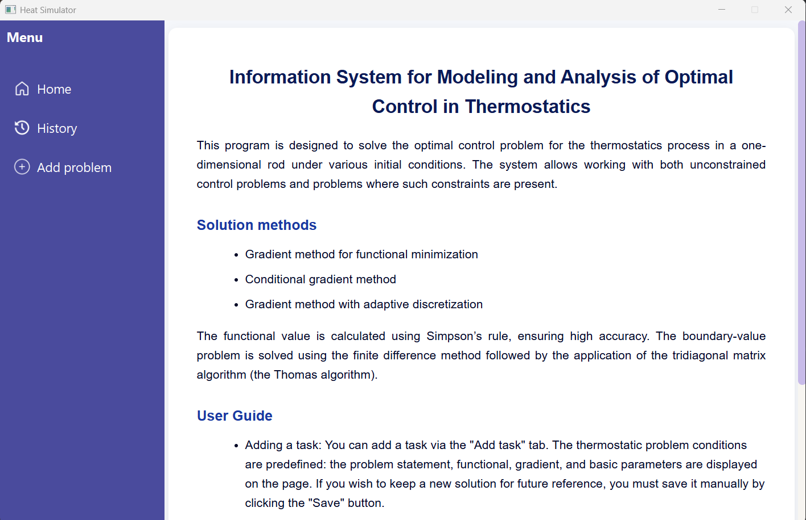
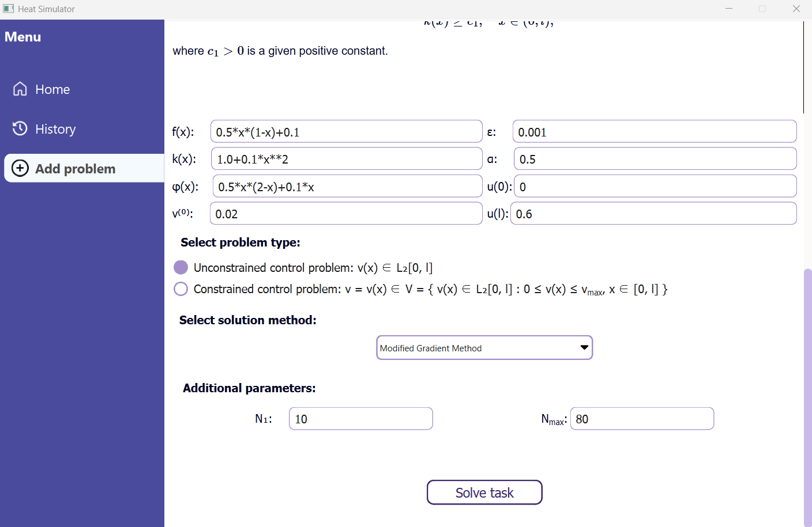
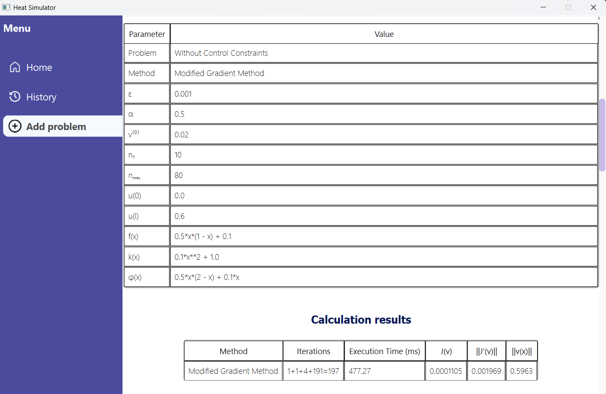
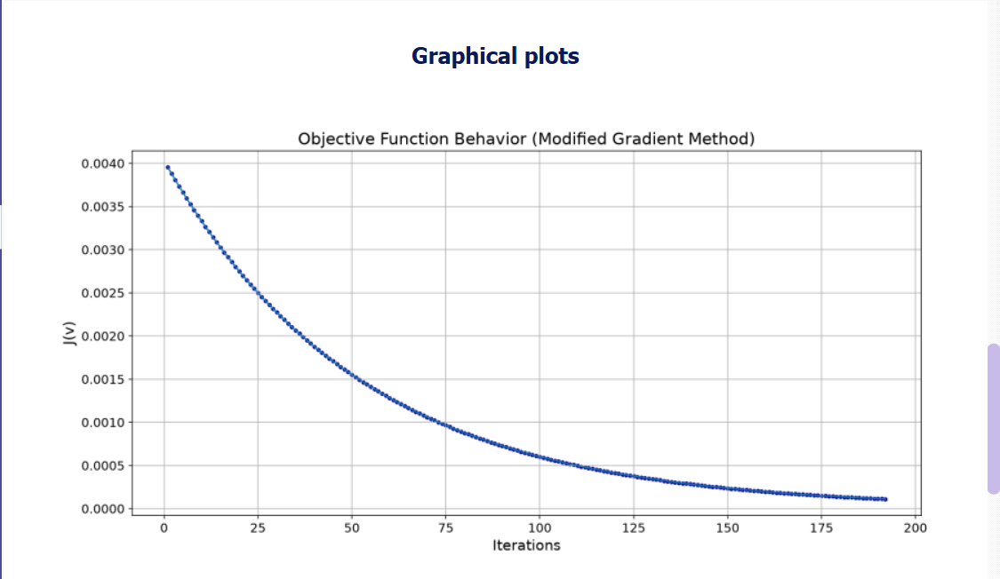
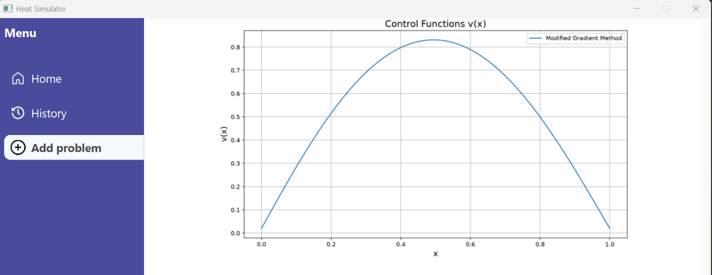
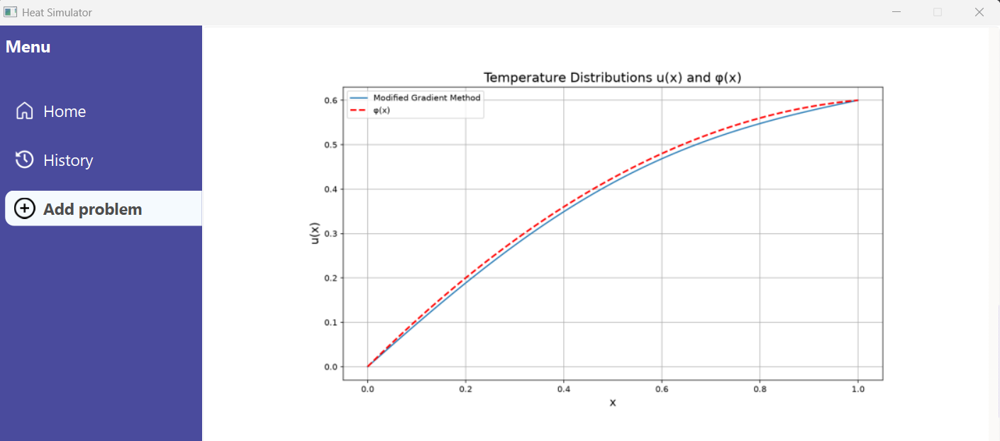
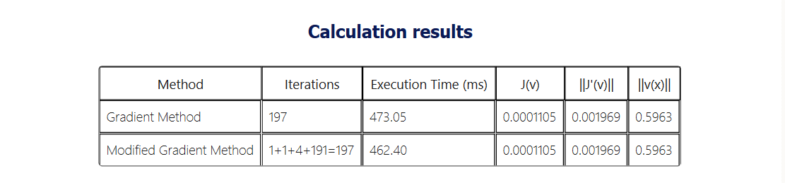
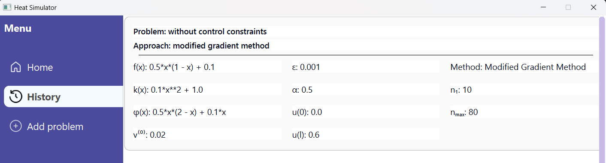

# Optimal Control of a 1D Heat Conduction Process

A Python-based desktop application for numerical optimization and comparative analysis of gradient-based methods applied to a stationary heat conduction problem in a one-dimensional rod.

## Overview

The application addresses an optimal control problem in which a distributed control function is used to minimize the deviation of the temperature distribution from a prescribed target profile.

Two problem formulations are supported:

**Unconstrained optimal control**

- Gradient descent with backtracking step-size reduction.
-	A projection-iteration modification of the gradient method with successive grid refinement.

**Box-constrained optimal control**

-	Conditional gradient method (Frank–Wolfe algorithm).
-	A projection-iteration modification of the conditional gradient method.

The application also supports comparative analysis of the classical and modified approaches.


## Problem Statement

Consider an optimal control problem for a stationary heat conduction process in a one-dimensional rod of length $l$, where $0 \leq x \leq l$. The temperatures at both endpoints of the rod are prescribed. The objective is to determine a distributed control function $v(x)$, representing the action of internal heat sources, such that the resulting temperature distribution $u(x;v)$ approximates a prescribed target profile $\varphi(x)$ as closely as possible.

The optimization problem is formulated as

```math
J(v)=\int_0^l \left(u(x;v)-\varphi(x)\right)^2\,dx.
```

subject to the stationary heat conduction equation

```math
Lu=f(x)+v(x), \qquad x\in(0,l),
```

with boundary conditions

```math
u(0)=g_0,\qquad u(l)=g_l.
```

The differential operator $L$ is defined by

```math
Lu=-\frac{d}{dx}\left(k(x)\frac{du}{dx}\right),
```

where $k(x)$ is the spatially varying thermal conductivity coefficient satisfying

```math
k(x)\geq c_1>0,\qquad x\in(0,l).
```

Here:

- $u(x;v)$ is the temperature distribution corresponding to the control $v(x)$;
- $\varphi(x)$ is the prescribed target temperature distribution;
- $f(x)$ describes the action of internal heat sources;
- $v(x)$ is the control function representing an additional distributed heat source;
- $g_0$ and $g_l$ are the prescribed endpoint temperatures;
- $l>0$ is the rod length.

Two optimal control formulations are considered:

**1. Unconstrained optimal control**

The control function belongs to the space of square-integrable functions:

```math
V=L^2(0,l).
```

**2. Box-constrained optimal control**

The admissible control set is defined as

```math
v=v(x)\in V=\left\{v(x)\in L^2(0,l):0\leq v(x)\leq v_{\max},\quad x\in[0,l]\right\},
```

where $v_{\max}>0$ is a prescribed upper bound on the control function.

## Numerical Approach

The optimal control problem is solved using gradient-based optimization methods. At each iteration, the state and adjoint boundary value problems are solved numerically to evaluate the objective functional and its gradient.

The boundary value problems are discretized using the finite difference method, and the resulting tridiagonal systems are solved using the Thomas algorithm. The objective functional is evaluated using Simpson's rule.

### Gradient Descent with Backtracking Step-Size Reduction

For the considered optimal control problem, the gradient of the objective functional is given by

```math
J'(v)=2p(x),
```

where $p(x)$ denotes the solution of the corresponding adjoint boundary value problem.

The control approximation is updated according to

```math
v_j^{(k+1)}=v_j^{(k)}-\alpha^{(k)}J'_j(v^{(k)}),\qquad j=0,\ldots,N,
```

where $\alpha^{(k)}>0$ is the step-size parameter, adjusted through successive reduction to obtain a decrease in the objective functional.

The iterative process terminates when

```math
\left\|v^{(k+1)}-v^{(k)}\right\|_h=\sqrt{h\cdot\sum_{j=0}^{N}\left(v_j^{(k+1)}-v_j^{(k)}\right)^2}<\varepsilon,
```

where $h$ is the spatial grid step and $\varepsilon>0$ is the prescribed stopping tolerance.

### Conditional Gradient Method (Frank–Wolfe)

For the box-constrained optimal control problem, the conditional gradient method constructs a feasible search direction by solving the auxiliary linear minimization problem

```math
\widehat{v}^{(k)}=\underset{v\in V}{\arg\min}\left\langle J'(v^{(k)}),v\right\rangle.
```

For the admissible control set defined in the **Problem Statement**, the solution is obtained pointwise:

```math
\widehat{v}^{(k)}(x)=
\begin{cases}
0, & J'(v^{(k)})(x)>0,\\
v_{\max}, & J'(v^{(k)})(x)<0,\\
\text{any value in }[0,v_{\max}], & J'(v^{(k)})(x)=0.
\end{cases}
```

The next control approximation is computed as

```math
v^{(k+1)}(x)=v^{(k)}(x)+\alpha_k\left(\widehat{v}^{(k)}(x)-v^{(k)}(x)\right),
```

where $\alpha_k$ is a step-size parameter chosen to ensure a monotonic decrease in the objective functional.


### Projection-Iteration Modification

The projection-iteration modification of the gradient method for solving the considered optimal control problem is described by the following algorithm.

**Initialization.** Specify $N_1$ and $N_{\max}$, where $N_1$ is the initial discretization order and $N_{\max}$ is the maximum discretization order. Initialize the total iteration counter $k_{\mathrm{sum}}=0$ and set the stage number $n=1$.

**Step 1.** Set the iteration counter at the $n$-th stage to $k=0$. Determine the discretization step $h_n=\frac{l}{N_n}$ and the corresponding computational tolerance $\varepsilon_n=C h_n^2$, consistent with the approximation error, where $C>0$ is a proportionality constant (an algorithm parameter).

Specify the initial approximation of the discrete control function:

```math
\widetilde{v}^{(0)}=\left(v_1^{(0)},v_2^{(0)},\ldots,v_{N_n}^{(0)}\right).
```

**Step 2.** Solve the discretized optimal control problem using the gradient method with computational tolerance $\varepsilon_n$. Determine the iteration number $k=k_n$ at which the stopping criterion is satisfied:

```math
\left\|\widetilde{v}^{(k)}-\widetilde{v}^{(k-1)}\right\|_{h_n}<\varepsilon_n.
```

**Step 3.** Update the total iteration counter:

```math
k_{\mathrm{sum}}:=k_{\mathrm{sum}}+k_n.
```

**Step 4.** Set $N_{n+1}=2N_n$. If $N_{n+1}>N_{\max}$, terminate the algorithm. Otherwise, proceed to **Step 5**.

**Step 5.** Perform piecewise linear interpolation of the discrete control function

```math
\widetilde{v}^{(k_n)}=\left(v_1^{(k_n)},v_2^{(k_n)},\ldots,v_{N_n}^{(k_n)}\right)
```

on the interval $[0,l]$ and construct the vector

```math
\widetilde{v}^{(0)}=\left(v_1^{(0)},v_2^{(0)},\ldots,v_{N_{n+1}}^{(0)}\right)
```

of interpolated values at the nodes of the uniform grid corresponding to the discretization order $N_{n+1}$.

**Step 6.** Set $n:=n+1$ and return to **Step 1**.

### Finite Difference Method

The evaluation of the objective functional requires solving the state boundary value problem, while the computation of its gradient additionally requires solving the corresponding adjoint problem.

The state equation is given by

```math
Lu=f(x)+v(x),
```

and the adjoint equation by

```math
Lp=u(x)-\varphi(x),
```

subject to the boundary conditions

```math
u(0)=g_0,\qquad u(l)=g_l,
```

```math
p(0)=0,\qquad p(l)=0.
```

The differential operator $L$ is defined as

```math
Lu=-\frac{d}{dx}\left(k(x)\frac{du}{dx}\right),
```

```math
Lp=-\frac{d}{dx}\left(k(x)\frac{dp}{dx}\right).
```

Expanding the derivatives yields

```math
k'(x)u'(x)+k(x)u''(x)=-f(x)-v(x),
```

and

```math
k'(x)p'(x)+k(x)p''(x)=\varphi(x)-u(x).
```

Both boundary value problems are discretized using the finite difference method on a uniform spatial grid. The resulting tridiagonal systems of linear algebraic equations are solved using the Thomas algorithm.

The objective functional is evaluated numerically using **Simpson's rule**.

## Application Features

The application provides a graphical interface for configuring, solving, and analyzing optimal control problems.

**Key capabilities include:**

- Problem configuration: specification of model functions, boundary conditions, initial control approximations, and numerical parameters.
- Numerical computation: execution of the implemented optimization methods for constrained and unconstrained problems.
- Method comparison: comparative analysis of classical and projection-iteration methods.
- Visualization: graphical representation of temperature distributions, control functions, objective functional values, and numerical results.
- Calculation history: storage and retrieval of problem configurations and computation results using SQLite.
- Data export: export of numerical results to Excel spreadsheets.
- Graphical interface: desktop application developed with PySide6.

## Technologies

**Language:** Python

**Numerical Computing:** NumPy, SciPy, SymPy

**GUI:** PySide6

**Visualization:** Matplotlib

**Database:** SQLite

**Data Export:** openpyxl

## Installation and Usage

**Requirements**

- Python 3.12
- Dependencies listed in requirements.txt

### Installation

Clone the repository:

```bash
git clone https://github.com/Amissa_Viator/HeatControlSim.git
cd HeatControlSim
```

Create and activate a virtual environment:

**Windows:**

```powershell
python -m venv .venv
.venv\Scripts\activate
```

**Linux / macOS:**

```bash
python3 -m venv .venv
source .venv/bin/activate
```

Install the required dependencies:

```bash
pip install -r requirements.txt
```

### Running the Application

Start the graphical interface:

```bash
python main.py
```

The database is automatically initialized if it does not already exist.

Alternatively, initialize the database without launching the GUI:

```bash
python main.py --init-db
```

To reset the database and remove generated result files:

```bash
python main.py --reset-db
```

**Warning:** The reset command permanently deletes the existing database records and generated files from the configured results and plots directories.

## Application Architecture

The application follows a modular architecture that separates the graphical user interface, numerical computations, data management, and result visualization.

The desktop interface is developed using PySide6, with interface layouts designed in Qt Designer. It allows users to configure optimal control problems, select numerical methods, initiate computations, and examine numerical and graphical results.

SymPy is used to process user-defined mathematical expressions and convert them into functions suitable for numerical evaluation.

The computational core implements the numerical methods described above, while NumPy and SciPy support numerical operations and data processing.

Matplotlib provides graphical visualization of computational results, while openpyxl enables their export to Excel spreadsheets.

### Project Structure

The main components of the project are organized as follows:

```text
HeatControlSim/
├── core/
│   ├── calculation/           # Numerical optimization algorithms
│   ├── data_worker/           # Problem parameters and data processing
│   ├── database/
│   │   ├── dao/
│   │   │   ├── repository/
│   │   │   └── service/
│   │   ├── db/                # Database schema and local storage
│   │   ├── entity/
│   │   └── utils/
│   ├── directors/             # Application workflow coordination
│   ├── excel_worker/          # Excel export
│   └── visualization/         # Result visualization
├── gui/
│   ├── design/
│   │   ├── html/
│   │   ├── icons/
│   │   └── style/
│   ├── ui/                    # Generated UI components
│   └── ui_logic/              # GUI event handling
├── resources/
│   ├── images/                # README screenshots and ER diagram
│   ├── plots/                 # Generated plots
│   └── results/               # Generated calculation results
├── main.py                    # Application entry point
├── requirements.txt           # Python dependencies
└── README.md                  # Project documentation
```

### Database Architecture

The application uses SQLite to store problem configurations, numerical parameters, calculation results, and references to generated files.

The database supports the retrieval of previously performed calculations, allowing users to review and analyze earlier results.

The entity-relationship diagram below illustrates the database structure.


## Application Screenshots

The application provides a graphical user interface with a sidebar for navigating between three main sections: **Home**, **History**, and **Add Problem**.

### Home

The **Home** page provides an overview of the application, its purpose, and basic usage instructions.



### Task Configuration

The **Add Problem** page allows users to specify the problem parameters, boundary conditions, mathematical functions, and numerical settings.

The available optimization methods depend on whether control constraints are imposed. Additional input fields are displayed dynamically according to the selected method, including the parameters required for projection-iteration modifications and method comparisons.



### Numerical Results and Visualization

After solving the problem, the application displays a summary table containing:

- Number of iterations and computation time (ms).
- Objective functional value $J(v)$.
- Gradient norm $\|J'(v)\|$.
- Control norm $\|v\|$.

The results are also visualized through plots of the control function, the objective functional, the computed and target temperature distributions, and the temperature distribution along the rod.









When method comparison is selected, the application presents the corresponding results for both approaches.



### Calculation History

The **History** page provides access to previously saved optimal control problems and their results. Users can reopen saved calculations for review or delete records that are no longer needed.



### Input Validation and Data Management

The application validates required fields, mathematical expressions, numerical parameters, and discretization settings before performing calculations. Invalid entries are highlighted, and corresponding error messages are displayed.

Users can save successfully computed tasks and export numerical results to Excel files.

**Note:** Generated files associated with saved calculations should not be moved or renamed, as the application stores references to their locations. To work with these files independently, create copies and modify them outside the application's storage directories.

## Limitations and Future Improvements

The current implementation provides the core functionality for solving and analyzing the considered optimal control problems. Potential improvements include:
- **Automated testing:** introducing unit and integration tests for numerical algorithms, data processing, and database operations, including validation against problems with known analytical solutions.
- **Code refactoring:** reducing duplicated data transformation and transfer logic, improving code maintainability and separation of responsibilities between modules.
- **Error handling:** extending the handling of numerical edge cases, convergence issues, and file-related errors.

## Related Publication

The numerical methods investigated in this project are related to the following research publication:

Hart L. L., Buhaienko A. O. (2025). *On the modification of direct methods for solving optimal control problems of stationary thermal processes.* *Challenges and Issues of Modern Science*, 4(1).

**DOI:** https://doi.org/10.15421/cims.4.314

The numerical results presented in this publication were obtained using an earlier implementation developed in Java. The current repository contains a Python-based information system implementing the corresponding optimization approaches.

## License and Usage

© 2026 Anna Buhaienko.

This project is intended for educational and research purposes only. You may view and use the code for non-commercial purposes, provided proper attribution is given. Commercial use, redistribution, or modification for public use requires explicit permission from the author.
